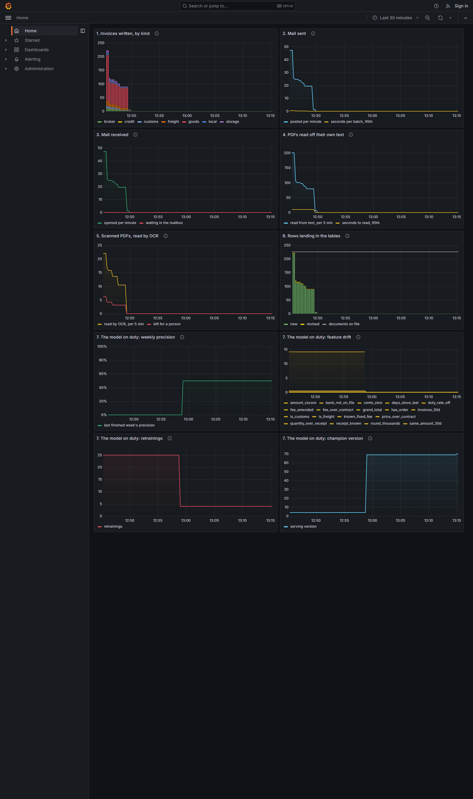

# Invoice anomalies

The model on duty for the invoices that
[project 01](../01-invoice-pipeline/README.md) simulates, reads and
files.

## The desk's day

About 5,600 invoices a year, about 200 of them wrong. Two people check
the five the model ranks first every week, and decide each one:
confirmed, dismissed, or still pending.

## The loop

1. **Flag**: the serving model scores the week; the top five go to the
   desk.
2. **Decide**: each check ends confirmed, dismissed, or pending.
3. **Label**: a confirmed flag trains as 1, a dismissed one as 0;
   pending teaches nothing.
4. **Watch**: the precision of finished weeks, and how far each feature
   moved from the eight weeks before.
5. **Retrain**: a fall, or a drift, starts a challenger on the verdicts.
6. **Promote**: four weeks judge the challenger; a better one takes
   over. A tie is not a win.



## The numbers

Ten kinds of error, planted by project 01 with an honest twin each: a
vendor with no order behind its bills, an account or sender the master
does not hold, more billed than received, a price above contract, the
same bill twice, a round adjustment, a delivery split under the
approval limit, a charge off the rate card, a duty at a rate not in
force, a broker fee above its contract.

Trained on four simulated years (seeds 1 to 4), tested once on a fifth
that nothing was tuned on, held out as `year-seed5`:

| Model | Top 5 a week that are anomalies | Anomalies in the weekly top 25 | Average precision |
|---|---|---|---|
| Rules a desk writes by hand | 0.53 | 0.90 | 0.73 |
| Isolation Forest, no labels | 0.23 | 0.72 | 0.17 |
| ECOD, no labels | 0.24 | 0.76 | 0.17 |
| **LightGBM**, labels known at the cutoff | **0.58** | **0.97** | **0.86** |

The rules earn their weights from the training weeks: how much a rule
raises the odds of a real error, never how sad a miss would be. The
held-out year is scored once and reported here; it does not choose the
serving model. The loop's own verdict does, on the weeks since the
challenger was trained.

At the customs stage the model finds every duty at a wrong rate and 80%
of the fees over contract. Two honesty tests guard the score: a model
handed the answer must be able to cheat, and a model fed shuffled
labels must score near the base rate.

## How to run it

```bash
cd ../01-invoice-pipeline
python run.py dataset year 1 2 3 4 5
python run.py dataset drift 7
cd ../02-invoice-anomalies
python -m pip install -r requirements.txt
python -m pytest -q
python run.py features        build the feature tables
python run.py walk            week by week over the training years
python run.py compare         four models, one held-out year, MLflow
python run.py retrain         the analyst's verdicts, challenged
python run.py loop            the whole story, week by week
python run.py score           the champion's scores for the dashboard
python run.py metrics         the gauges Prometheus scrapes, port 9109
python run.py ui              MLflow on http://localhost:5000
```

`retrain` prints four lines: the weeks trained on, the champion's
score, the challenger's score, and which one serves now. `loop` prints
the fall, the retrainings, the promotion and the recovery.

## The files

```text
02-invoice-anomalies/
├── run.py                  - features, walk, compare, retrain, loop, score, metrics, ui
├── src/
│   ├── data/load.py        - one dataset from project 01
│   ├── features/build.py   - twenty-four features, none from the future
│   ├── evaluation/
│   │   ├── metrics.py      - top k per week, recall, twin alarms
│   │   ├── reading.py      - perfect data against what was read
│   │   ├── splits.py       - by time, labels that arrive late
│   │   └── watch.py        - weekly precision, floor, slipping, drift
│   ├── models/
│   │   ├── exporter.py     - the figures as Prometheus gauges
│   │   ├── feedback.py     - the analyst's verdict as a label
│   │   ├── lifecycle.py    - walk forward, retrain, challenge, promote
│   │   ├── rules.py        - the desk's checks, the bar to beat
│   │   ├── scoring.py      - scores, stages and decisions for project 03
│   │   └── train.py        - four models, recorded in MLflow
│   └── runs/loop.py        - the loop, week by week
└── tests/                  - the same folders
```
