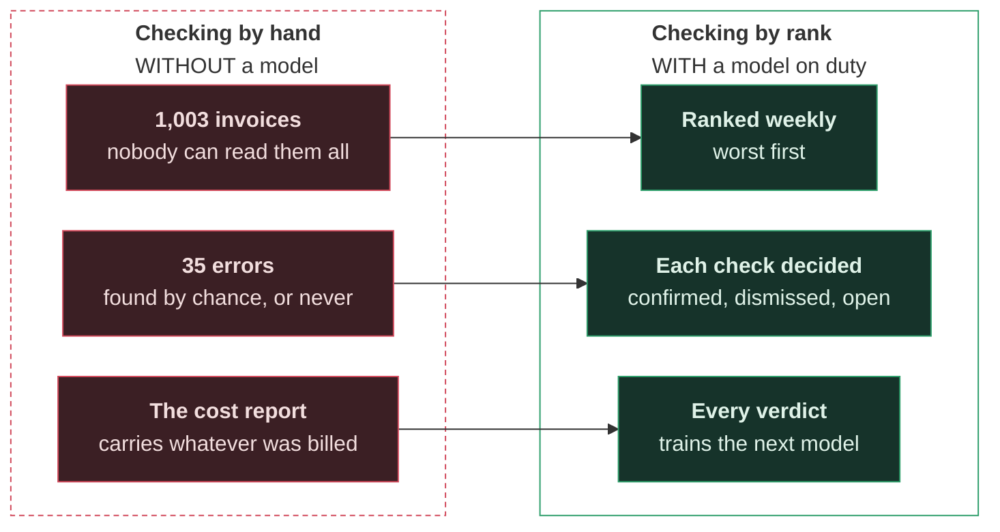
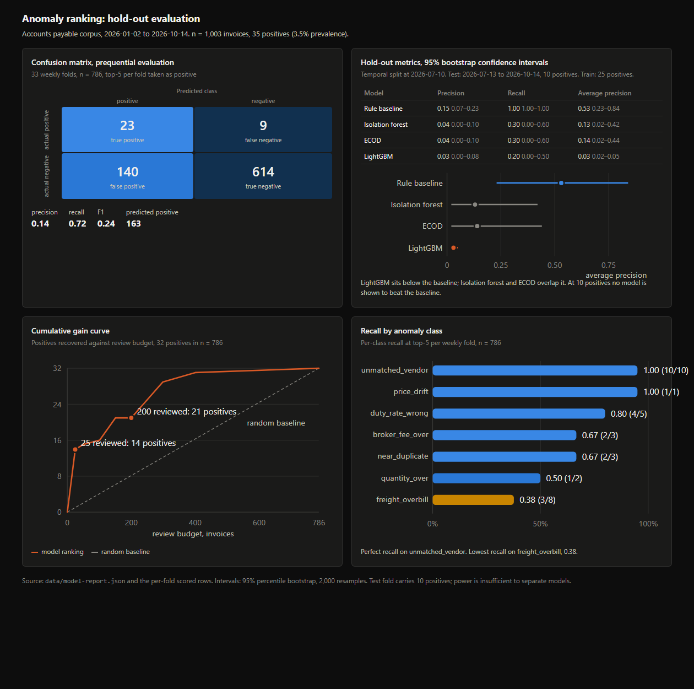

# Invoice anomalies

Ranks a cost department's invoices so the wrong ones are looked at
first, and proves on measured evidence whether that is worth doing.

[Tutorial](docs/tutorial.md) · [Reference](docs/reference.md) ·
[Sources](docs/sources.md) · [Reading order](docs/reading-order.md)

**The invoices are filed at last. Some of them are wrong.**

Moty imports cosmetics packaging from Asia: bottles, caps, pumps,
labels. Its plant is in São Paulo state; Moty
itself is invented. Factories, shipping lines, forwarders, a customs
broker, a terminal and a truck company bill it.

You work in **Production and Logistics Cost Management**. The earlier
piece of work got every invoice out of the mail and into rows, so you
finally know **what every part cost to land at the plant**. It also
wrote down, apart from the rows, *which invoices it had billed wrong on
purpose.* That answer key is the only reason anything here can be
scored.

Now the problem changes. The run holds **1,003 invoices and 35 real
errors**, with another 46 built to draw a false positive. In an
average week that is 24 invoices and 1 error.

The department does not pay these invoices. **A wrong invoice is a
wrong number in the cost report**, and nobody reads a thousand pages
looking for 35. So the invoices are ranked, worst first, and each one
that is checked ends up confirmed, dismissed, or still open.



Why it matters:

- A typical company pays **1.5% of its disbursements** twice or in
  error [[1]](docs/sources.md).
- **3 to 6 of every 100** freight invoices carry an **error**
  [[2]](docs/sources.md).

Every number in this project, and where it comes from:
[sources](docs/sources.md).

## How the work is organised

The project follows **CRISP-DM**, the cross-industry standard process
for data mining (Chapman et al., 2000): six phases, run in order and
revisited as often as the work demands.

| Phase | Here |
|---|---|
| **Business understanding** | a wrong invoice is a wrong number in the cost report; the department can check only a few a week |
| **Data understanding** | 1,003 invoices, 35 errors, 46 false positives, and the records they are checked against |
| **Data preparation** | one row per invoice, built only from what was knowable on its own date |
| **Modeling** | the checks a clerk makes by hand, then models trained on the errors already found |
| **Evaluation** | trained on earlier weeks, tested on later ones: confusion matrix, precision, recall, F1, the precision-recall curve and its average precision, against a baseline of the clerk's own checks |
| **Deployment** | the ranking is published, each verdict is recorded, and the model is retrained and replaced on that evidence |

Deployment is not the end. CRISP-DM is a cycle, and this project runs
it continuously: the verdicts become labels, the labels train the next
model, and the next model is measured before it replaces the one on
duty.



*Measured on the run, not drawn by hand.
[The page itself](docs/panels.html) carries the same figures.*

## What is actually in the run

The answer key names each error and, beside it, the correct invoices
built to be mistaken for one. Across its 1,044 rows it holds 37 errors
and 48 false positives.

| Error | Real | False positives |
|---|---|---|
| a vendor billing with no order behind it | 10 | 2 |
| a freight charge not on the rate card | 10 | 20 |
| a duty at a rate not in force | 5 | 2 |
| a broker fee above its contract | 5 | 6 |
| the same bill again under a new number | 3 | 11 |
| a price above the contract | 2 | 0 |
| more billed than the dock received | 2 | 0 |
| an account or sender the master does not hold | 0 | 6 |
| a round adjustment to the total | 0 | 1 |
| a delivery split under the approval limit | 0 | 0 |
| **total** | **37** | **48** |

Counted once per invoice number, the run holds 1,003 invoices, 35
errors and 46 false positives: 41 numbers were issued twice, revised or
resent, and their repeats carry no new error.

Three kinds never happened in these 9½ months. **Two of them appear
only as false positives**, which is the harder case: a bank change that
was announced and recorded, and a fixed fee that lands on a round
number. The model will be asked about them without ever having seen the
real thing.

## Results

**The clerk's twelve checks come out ahead.** On the errors held back
from July to October, the checks caught every one; no model caught more
than three. The checks' interval for average precision sits clear of
the gradient-boosted model's, but it overlaps the two unsupervised
models', so the comparison with the best model is not decided: the checks are ahead on
the estimate, not separated from every model by the evidence.

Served week by week, the ranking is worth having: of the 32 errors in
the 786 invoices it scored, **23 reached a weekly top five**, at 140
false positives. Read from the top, the checks' first 25 test invoices
carry 7 of the 10 errors, against 1 expected by chance.

| Model | Precision | Recall | Average precision |
|---|---|---|---|
| Clerk's checks (`rules`) | 0.15 (0.07 to 0.23) | 1.00 (1.00 to 1.00) | 0.53 (0.23 to 0.84) |
| LightGBM | 0.03 (0.00 to 0.08) | 0.20 (0.00 to 0.50) | 0.03 (0.02 to 0.05) |
| Isolation forest | 0.04 (0.00 to 0.10) | 0.30 (0.00 to 0.60) | 0.13 (0.02 to 0.42) |
| ECOD | 0.04 (0.00 to 0.10) | 0.30 (0.00 to 0.60) | 0.14 (0.02 to 0.44) |

Measured on the 10 errors between 2026-07-13 and 2026-10-14, trained
on the 25 errors before them. Each figure carries its 95% interval: a
precision read off ten events cannot separate two models, and here
none of the intervals do.

## What this cannot claim

35 errors is a small number, and saying so is part of the work.

- A time split leaves about a dozen errors to be tested on. Any
  precision measured on a dozen events carries a wide interval, so
  **every figure is published with its interval**, and two models whose
  intervals overlap are reported as not separated.
- 24 features against 35 errors is far past the usual rule of ten
  events per feature. The feature set is cut, and the cut is reported.
- The invoices are simulated and the simulation is known. More of them
  would narrow the intervals **around the simulator**, not around a
  real supplier.
- 6 of the 35 errors only come to light after 14 October, the last day
  of the run, so no verdict can ever confirm them.
- **The retraining half of the loop barely works on this run.** In 33
  weeks it retrained 13 times, every time on drift, and promoted
  nothing. A week holds about 24 invoices, too few for a drift measure
  to mean much, and four weeks of a challenger are too few for two
  recall intervals to separate. The loop runs and logs; it does not
  show that a model improves itself here.

So the project makes two separate claims, and keeps them apart: that
the system operates, shown by it running and logging; and that the
model finds errors, bounded by data that is not real.

## How to run it

```bash
python -m pip install -r requirements.txt
python -m pytest -q
python run.py prepare        load the run, build and cut the features
python run.py train          split by time, fit every model, report
python run.py score          one model over the whole run, into data/scored.csv
python run.py watch          walk the run week by week, into data/anomalies.csv
python run.py serve          keep the gauges up
```

Every command appends one JSON line to `data/runs.log`, so days of
running stay readable.

`watch` is the only writer of `data/anomalies.csv`, the file the landed
cost dashboard shows. It picks up where it left off, so running it twice
costs nothing. The dashboard copies it in with its own
`refresh_live_data.py`.

## The files

```text
02-invoice-anomalies/
├── run.py                  - the commands
├── src/
│   ├── data/load.py        - the run, as typed tables
│   ├── features/build.py   - the features, none from the future
│   ├── evaluation/
│   │   ├── metrics.py      - confusion matrix, precision, recall, F1
│   │   ├── intervals.py    - the interval around every figure
│   │   ├── reading.py      - perfect data against what was read
│   │   ├── splits.py       - by time, labels that arrive late
│   │   └── watch.py        - weekly precision, drift
│   ├── models/
│   │   ├── exporter.py     - the figures the dashboard reads
│   │   ├── feedback.py     - the verdict as a label
│   │   ├── lifecycle.py    - retrain, challenge, promote
│   │   ├── rules.py        - the clerk's checks, the bar to beat
│   │   ├── scoring.py      - scores and decisions
│   │   └── train.py        - the models; an MLflow comparison no command uses
│   └── runs/loop.py        - the loop, week by week
└── tests/                  - the same folders
```
